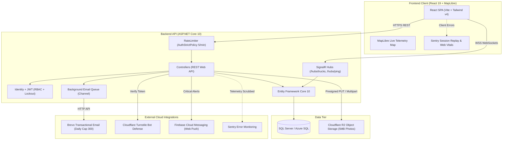

# AquaBophelo

**A water monitoring and truck tracking web system for Sol Plaatje Municipality, Kimberley, Northern Cape.**

Project · Diploma in ICT · Sol Plaatje University · `PROJECT(20262FNPRT630)`
Phase 4 (Implementation & Presentation) due **1 October 2026**.

---

## What is AquaBophelo?

*Bophelo* means "life", and water is exactly that. AquaBophelo helps a municipality and its residents answer two everyday questions:

1. **How much water do we have?** Dam levels are recorded, charted over time and colour-coded by status, with automatic alerts when levels drop.
2. **Where is the water truck?** Drivers broadcast their live GPS position while delivering water, and residents and admins watch the trucks move on a map in real time.

### User roles

| Role | What they do |
|---|---|
| **Resident** | View dam levels and trends, see live water trucks and schedules, subscribe to area Email alerts, report water fault tickets |
| **Driver** | See the assigned truck and route, start/end trips, broadcast GPS, mark stops complete |
| **Admin** | Manage dams, readings, trucks, drivers, routes, users, driver/staff accounts, and broadcast email alerts |

---

## Tech stack & Design Grounding

| Layer | Technology |
|---|---|
| Frontend | React (JavaScript) · Vite · Tailwind CSS · React Router · **MapLibre GL JS (maps)** · OpenStreetMap · TanStack React Query · Chart.js |
| Backend | ASP.NET Core Web API (C#) · Entity Framework Core · SQL Server / Azure SQL |
| Auth | ASP.NET Core Identity + JWT, role-based (Resident / Driver / Admin) + Email OTP verification |
| Real-time | SignalR |
| API docs | OpenAPI + Scalar |
| Notifications | **Email Notifications & Email OTP Verification** *(Pivoted 100% from SMS to Email for zero-cost operation and higher reliability)* · CAT (Central Africa Time, UTC+2) |
| Hosting | Vercel / Netlify (frontend) · Azure App Service + Azure SQL (backend) |
| **UX & HCI** | **Human-Computer Interaction (HCI) Principles · Nielsen's 10 Usability Heuristics · WCAG 2.1 AA Accessibility** |

---

## Team

| Member | Role |
|---|---|
| Sisekelo Masombuka | Backend |
| Nosipho Mbatha | Backend |
| Nomcebo Nkosi | Frontend |
| Jabulile Shabalala | Frontend |

---

## Repository structure

```
AquaBophelo/
├── backend/
│   ├── AquaBophelo.slnx              Solution file (open this in Visual Studio)
│   └── AquaBophelo/                  ASP.NET Core Web API project
├── frontend/                         React + Vite + Tailwind app
├── docs/                             Project documentation, ER diagram, task briefs
├── .gitignore
├── .gitattributes
└── README.md
```

---

## Getting started

### 1. Prerequisites

Install these once:

- **Git**
- **.NET SDK** matching the `TargetFramework` in `backend/AquaBophelo/AquaBophelo.csproj` (for example .NET 9 for `net9.0`)
- **Node.js** (current LTS)
- **Visual Studio 2022** with the *ASP.NET and web development* workload and *SQL Server Express LocalDB* (or use VS Code with the C# extension)
- **EF Core CLI tool:** `dotnet tool install --global dotnet-ef`

### 2. Clone

```
git clone https://github.com/Sisekelo-Masombuka/AqueBophelo.git
cd AqueBophelo
```

(The GitHub repo name is spelled *Aque*; the project and folder names inside are spelled *Aqua*. That's expected.)

### 3. Trust the local HTTPS certificate (once per machine)

```
dotnet dev-certs https --trust
```

Click **Yes** on the Windows dialog. Without this, your browser will block calls from the frontend to the local API.

### 4. Run the backend

```
cd backend\AquaBophelo
dotnet run --launch-profile https
```

Or open `backend/AquaBophelo.slnx` in Visual Studio and press **F5** using the `https` profile.

- The API port is defined in `backend/AquaBophelo/Properties/launchSettings.json`.
- Interactive API docs (Scalar) open from the same address; check `Program.cs` for the exact route.
- Quick check: `GET /api/v1/health` should return `200` with `"status": "ok"`.

### 5. Run the frontend

In a **second** terminal:

```
cd frontend
npm install
npm run dev
```

The app runs at **http://localhost:5173**. The URL of the API is set in `frontend/.env.development` (`VITE_API_BASE_URL`); it must match the port from step 4.

### 6. Check that everything is connected

Open http://localhost:5173. The **System Check** page should show **API: Online** and **Live: Connected**. If not:

| Symptom | Likely fix |
|---|---|
| API Offline, certificate error in the console | Run `dotnet dev-certs https --trust` (step 3) and restart the browser |
| API Offline, CORS error in the console | Make sure the frontend is on port `5173` and `Cors:AllowedOrigins` in `appsettings.Development.json` contains `http://localhost:5173` |
| API Offline, connection refused | The API isn't running, or `VITE_API_BASE_URL` has the wrong port |
| Port 5173 already in use | Close the other process; the port is fixed on purpose so CORS stays predictable |

---

## Production Integrations & Security Architecture

AquaBophelo integrates six core external services to deliver enterprise-grade performance, bot protection, telemetry, and reliable citizen communications:



---

## Technical Documentation & Architecture Guides

Detailed system documentation is available in the [`docs/`](docs/) directory:

| Guide | Description |
| :--- | :--- |
| [**Authentication Guide (`docs/AUTH.md`)**](docs/AUTH.md) | Identity architecture, JWT tokens, RBAC roles, 6-digit SHA-256 OTP verification, 5-strike brute-force lockout, and soft-delete grace periods. |
| [**Alerts & Notifications (`docs/ALERTS.md`)**](docs/ALERTS.md) | Reservoir capacity thresholds (Healthy/Watch/Warning/Critical), state-transition deduplication, asynchronous queue pipeline, and Brevo daily cap protection. |
| [**Error Handling Guide (`docs/ERROR-HANDLING.md`)**](docs/ERROR-HANDLING.md) | RFC 7807 ProblemDetails responses, standard HTTP status codes, external service fail-safes, and Axios network failover. |
| [**Security & POPIA Guide (`docs/SECURITY.md`)**](docs/SECURITY.md) | South African POPIA compliance, IDOR ownership controls, Cloudflare R2 upload restrictions, rate limiting, and HTTP security headers. |

---

## Master Environment Variables & Secrets Reference

### 1. Backend Secrets (`dotnet user-secrets` in Dev / Azure App Settings in Prod)

| Variable Name | Description | Example Value / Source |
|---|---|---|
| `ConnectionStrings__DefaultConnection` | SQL Server / Azure SQL Connection String | `Server=...;Database=AquaBopheloDb;...` |
| `Jwt__Key` | Secret key used to sign JWT Tokens | 64-character hex string |
| `Jwt__Issuer` | JWT Token Issuer | `AquaBopheloApi` |
| `Jwt__Audience` | JWT Token Audience | `AquaBopheloClient` |
| `Brevo__ApiKey` | Brevo Transactional Email HTTP API Key | `xkeysib-123456...` |
| `Brevo__SenderEmail` | Verified Municipal Sender Email Address | `notifications@solplaatje.gov.za` |
| `Brevo__SenderName` | Sender Display Name | `Sol Plaatje Water Care` |
| `R2__AccountId` | Cloudflare R2 Account ID | `32-character hex ID` |
| `R2__AccessKeyId` | Cloudflare R2 API Access Key ID | R2 Access Key |
| `R2__SecretAccessKey` | Cloudflare R2 API Secret Access Key | R2 Secret Key |
| `R2__BucketName` | Cloudflare R2 Bucket Name | `aquabophelo-uploads` |
| `Turnstile__SecretKey` | Cloudflare Turnstile Bot Protection Secret Key | `0x4AAAAAA...` |
| `Sentry__Dsn` | Sentry ASP.NET Core Project DSN | `https://...@...ingest.sentry.io/...` |
| `Firebase__ServiceAccountPath` | Relative path to Firebase Admin Private Key JSON | `firebase-service-account.json` |

### 2. Frontend Configuration (`frontend/.env`)

| Variable Name | Description | Example Value / Source |
|---|---|---|
| `VITE_API_BASE_URL` | Backend API Base Endpoint | `https://localhost:7153` |
| `VITE_TURNSTILE_SITE_KEY` | Cloudflare Turnstile CAPTCHA Public Site Key | `0x4AAAAAA...` |
| `VITE_SENTRY_DSN` | Sentry React Project DSN | `https://...@...ingest.sentry.io/...` |
| `VITE_FIREBASE_API_KEY` | Firebase Web Project API Key | `AIzaSy...` |
| `VITE_FIREBASE_PROJECT_ID` | Firebase Project ID | `aquabophelo-notifications` |
| `VITE_FIREBASE_MESSAGING_SENDER_ID` | Firebase Sender ID | `1234567890` |
| `VITE_FIREBASE_APP_ID` | Firebase Web App ID | `1:1234567890:web:1234567890` |
| `VITE_FIREBASE_VAPID_KEY` | FCM Web Push Certificate Public VAPID Key | `B...` |
| `VITE_GA_MEASUREMENT_ID` | Google Analytics Measurement ID | `G-XXXXXXXXXX` |

---

## Step-by-Step Integration Setup Guide

### 📧 1. Brevo Transactional Email Service
1. Create a free account at [brevo.com](https://www.brevo.com).
2. Verify your municipal sender email address under **Senders & IP**.
3. Generate an API Key under **SMTP & API** -> **API Keys**.
4. Configure `Brevo:ApiKey`, `Brevo:SenderEmail`, and `Brevo:SenderName` in backend secrets.

### ☁️ 2. Cloudflare R2 Object Storage
1. Log in to [dash.cloudflare.com](https://dash.cloudflare.com) and navigate to **R2**.
2. Create a bucket named `aquabophelo-uploads`.
3. Go to **Manage R2 API Tokens** -> **Create API Token** (Permissions: *Object Read & Write*).
4. Configure CORS on the bucket for your frontend origin (`http://localhost:5173`).
5. Configure `R2:AccountId`, `R2:AccessKeyId`, `R2:SecretAccessKey`, and `R2:BucketName` in backend secrets.

### 🤖 3. Cloudflare Turnstile Bot Protection
1. In Cloudflare Dashboard, navigate to **Turnstile** -> **Add Site**.
2. Set Domain to `localhost` (or your production domain).
3. Copy **Site Key** to `VITE_TURNSTILE_SITE_KEY` in `frontend/.env`.
4. Copy **Secret Key** to `Turnstile:SecretKey` in backend secrets.

### 📊 4. Sentry Application Monitoring & Telemetry
1. Create a free account at [sentry.io](https://sentry.io).
2. Create project `aquabophelo-backend` (ASP.NET Core) -> Copy DSN to `Sentry:Dsn` in backend secrets.
3. Create project `aquabophelo-frontend` (React) -> Copy DSN to `VITE_SENTRY_DSN` in `frontend/.env`.

### 🔔 5. Firebase Cloud Messaging (Web Push)
1. Create a project at [console.firebase.google.com](https://console.firebase.google.com).
2. Add a Web App (`</>`) and copy config values to `frontend/.env`.
3. Under **Project settings** -> **Cloud Messaging**, click **Generate keypair** under Web Push certificates -> copy VAPID key to `VITE_FIREBASE_VAPID_KEY`.
4. Under **Service accounts**, click **Generate new private key** -> download JSON file to `backend/AquaBophelo/firebase-service-account.json`.

### 📈 6. Google Analytics (POPIA Compliant)
1. In Firebase Console or [analytics.google.com](https://analytics.google.com), copy your Web Stream **Measurement ID** (`G-XXXXXXXXXX`).
2. Add `VITE_GA_MEASUREMENT_ID=G-XXXXXXXXXX` to `frontend/.env`.
3. Google Analytics script is dynamically blocked until the resident clicks *"Accept All"* on the POPIA cookie banner.

---

## Academic note

AquaBophelo is a student capstone project developed at Sol Plaatje University. Sol Plaatje Municipality is the client context for the design; this is not an official municipal system.

