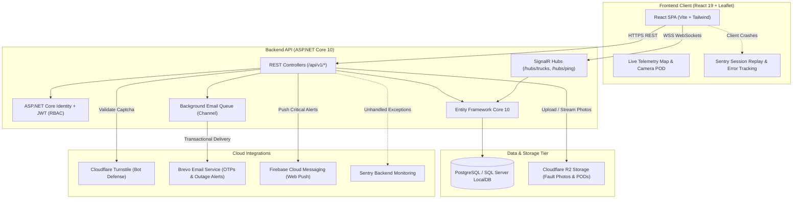

# AquaBophelo

**Smart Municipal Water Monitoring, Tanker Telemetry, and Resident Alerting Platform**  
*Sol Plaatje Municipality · Kimberley, Northern Cape, South Africa*  
*Developed by VibeTech · Sol Plaatje University*  
*Production Deployment:* [https://aquabophelo.app/](https://aquabophelo.app/)

---

## 📌 Executive Summary

*AquaBophelo* (from Latin *Aqua* for water and Sesotho/Setswana *Bophelo* for life) is an enterprise-grade municipal water monitoring and emergency tanker telemetry platform designed for the Sol Plaatje Local Municipality. It addresses two critical municipal crises:
1. **Water Reservoir Depletion & Outages:** Continuous tracking of dam storage levels, historical replenishment trends, scheduled maintenance outages, and citizen fault reporting.
2. **Emergency Water Delivery Distribution:** Real-time GPS tracking and live WebSocket broadcasting of municipal water tankers, digital delivery manifests, and live photo Proof of Delivery (POD).

---

## 👥 VibeTech Team

| Team Member | Role |
| :--- | :--- |
| **Nosipho Mbatha** | Backend & Database Engineering |
| **Nomcebo Nkosi** | Frontend & User Interface Engineering |
| **Sisekelo Masombuka** | Architecture, Security & Full-Stack Integration |
| **Jabulile Shabalala** | Frontend, Testing & Documentation |

---

## 🗂️ Clean Repository Structure

As required for submission and professional deployment, all source code, media, and academic documentation are organized into clean top-level directories:

```text
AquaBophelo/
├── Code/
│   ├── backend/                      ASP.NET Core 10 Web API + Entity Framework Core + SignalR
│   │   ├── AquaBophelo.slnx          Modern solution file (open in Visual Studio / VS Code)
│   │   ├── AquaBophelo/              Controllers, DTOs, Hubs, Migrations, Models & Services
│   │   └── AquaBophelo.Tests/        xUnit unit and integration test suite (20/20 passing)
│   └── frontend/                     React 19 + Vite + Tailwind CSS Single-Page Application
│       ├── src/                      UI components, pages, hooks, context & state management
│       ├── public/                   Static assets, icons, and Firebase service workers
│       └── package.json              Vite build scripts and client dependency specifications
├── Demo/
│   └── AquaBophelo_System_Demonstration.mp4    Official system demonstration video (Git LFS)
├── Dox/
│   ├── Project Proposal.pdf          Phase 1: Project Proposal & Scope Definition
│   ├── Requirements Specifications.pdf Phase 2: Software Requirements Specification (SRS)
│   ├── Phase 3 PROJECT FINAL .pdf    Phase 3: System Design, ERDs & Architecture
│   └── Final Phase Four 4.pdf        Phase 4: Implementation, Testing & Evaluation Report
├── VibeTech-Names.txt                Group VibeTech student roster & repository link
├── README.md                         Comprehensive project documentation & run instructions
├── .gitignore                        Multi-stack repository ignore rules (.NET + Node)
└── .gitattributes                    Line endings & Git LFS large asset configuration
```

---

## 🛠️ Technology Stack & Cloud Ecosystem

### 1. Frontend Client
- **Framework:** React 19 (JavaScript SPA) powered by Vite 8
- **Styling:** Tailwind CSS with responsive mobile-first municipal design system
- **Mapping & Telemetry:** Leaflet / MapLibre GL JS with custom SVG tanker pins and reservoir markers
- **Real-Time Client:** `@microsoft/signalr` WebSocket client with automatic reconnection and fallback
- **State & Data Fetching:** TanStack React Query + Axios with RFC 7807 problem details parsing
- **UI & Icons:** Lucide React icons, Radix UI accessible primitives, and customized camera capture components
- **Monitoring:** Sentry React SDK (session replay, error reporting, and performance vitals)

### 2. Backend API & Services
- **Runtime & Framework:** .NET 10 (C# 14) ASP.NET Core Web API
- **ORM & Data Access:** Entity Framework Core 10 with Code-First Migrations and composite performance indexes
- **Authentication:** ASP.NET Core Identity + JWT Bearer Tokens with role-based access control (`Admin`, `Driver`, `Resident`)
- **Real-Time Engine:** SignalR Hubs (`/hubs/trucks` for sub-second GPS telemetry and `/hubs/ping` for heartbeat monitoring)
- **Background Processing:** System `Channel<T>` asynchronous email queue background service
- **API Documentation:** OpenAPI 3.0 with Scalar interactive API viewer

### 3. Database
- **Engine:** PostgreSQL / SQL Server LocalDB compatible via EF Core
- **Performance:** Composite B-tree indexes for truck location telemetry, OTP verification codes, emergency alerts, and audit logs
- **Compliance:** POPIA-compliant soft deletion with a 30-day permanent deletion cleanup cycle

### 4. Cloudflare Ecosystem (Turnstile & R2 Storage)
- **Cloudflare Turnstile (Bot & Anti-Abuse Defense):**
  - Integrated into resident registration and password recovery forms.
  - Replaces traditional friction-heavy CAPTCHAs with invisible, privacy-preserving cryptographic challenges.
  - Backend verifies tokens directly against Cloudflare's `/turnstile/v0/siteverify` API endpoint.
- **Cloudflare R2 Object Storage (High-Performance Zero-Egress Media):**
  - High-availability, S3-compatible distributed object storage.
  - Handles citizen water fault photo uploads (e.g. burst pipes, leaks) and driver live Proof of Delivery (POD) photo captures.
  - Enforces strict 5MB upload limits and image MIME-type validation.
  - **Graceful Local Fallback:** When R2 credentials are unset, the system automatically persists uploads to disk under `uploads/reports` and streams them to the admin panel via secure proxy endpoints (`/api/v1/reports/photos/{key}`).

### 5. Notifications & Telemetry
- **Brevo Transactional Email:** High-reliability municipal communications sending 6-digit SHA-256 hashed OTPs, emergency water interruption alerts, and ticket confirmations.
- **Firebase Cloud Messaging (FCM):** Web push notifications for instant critical water alerts.
- **Sentry Application Performance Monitoring:** Dual-tier error reporting across frontend and backend.

---

## 🔒 Administrator Provisioning & Operational Security

Administrator accounts are provisioned **strictly when explicitly configured via protected environment variables** (`ADMIN_EMAIL` and `ADMIN_INITIAL_PASSWORD`). Production deployments must never rely on repository defaults.

| Role | Administrative Identity Provisioning | Initial Credential Setup | Privileges |
| :--- | :--- | :--- | :--- |
| **Municipal Admin** | Configured via `ADMIN_EMAIL` (e.g., `admin@aquabophelo.app`) | Configured securely via `ADMIN_INITIAL_PASSWORD` environment variable or `.NET user-secrets` | Full Municipal Control Center, Fleet & Route Management, User Administration, Outage Scheduling, Fault Ticket Review |

*Note: For production and local environments, define `ADMIN_INITIAL_PASSWORD` and `ADMIN_EMAIL` in your hosting environment variables, Azure App Service configuration, or `.NET user-secrets` (`dotnet user-secrets set "Admin:InitialPassword" "YourStrongSecretPassword!"`). If unset in production, automatic administrator provisioning is safely skipped to prevent unauthorized access.*

---

## 🚀 Getting Started & Local Development

### 1. Prerequisites
- **.NET SDK 10.0** (or .NET 9.0+)
- **Node.js** (v20+ recommended) & **npm**
- **Git** & **Git LFS** (`git lfs install`)

### 2. Clone the Repository
```bash
git clone https://github.com/Sisekelo-Masombuka/AqueBophelo.git
cd AqueBophelo
git lfs pull
```

### 3. Run the Backend API
In your first terminal:
```bash
dotnet run --project Code/backend/AquaBophelo --launch-profile https
```
- API Base URL: `https://localhost:7154` (HTTP: `http://localhost:5094`)
- Health Check: `GET http://localhost:5094/api/v1/health` -> `{"status":"ok"}`
- Interactive Scalar API Docs: `https://localhost:7154/scalar/v1`

### 4. Run the Frontend Application
In your second terminal:
```bash
cd Code/frontend
npm install
npm run dev
```
- Frontend Web App: `http://localhost:5173`

### 5. Running Automated Tests
Run the automated backend xUnit unit, integration, and security test suite:
```bash
dotnet test Code/backend/AquaBophelo.slnx
```
**Backend Test Results:** `37 Passed, 0 Failed, 0 Skipped` (100% pass rate).

Run the automated frontend Vitest test suite:
```bash
cd Code/frontend
npm test
```
**Frontend Test Results:** `20 Passed, 0 Failed, 0 Skipped` (100% pass rate across 5 test suites covering Registration & OTP flow, Authentication, Live Tankers, Admin Operations, and Fault Reporting).

### 6. Containerized Deployment (Docker)
The backend container is hardened to run as a non-root user (`app`, UID 1654) and binds strictly to port 8080:
```bash
# Backend (binds to http://localhost:8080)
docker build -f Code/backend/Dockerfile -t aquabophelo-backend .
docker run -p 8080:8080 -e ASPNETCORE_ENVIRONMENT=Production aquabophelo-backend

# Frontend (Nginx alpine with 1-year immutable caching for static assets)
docker build -f Code/frontend/Dockerfile -t aquabophelo-frontend .
docker run -p 3000:80 aquabophelo-frontend
```

---

## 🏗️ System Architecture & Data Flow



---

## 📑 Academic Documentation Breakdown

All official phase submission documents are located in [`Dox/`](Dox/):

1. **[`Phase 1: Project Proposal.pdf`](Dox/Project%20Proposal.pdf)** — Problem statement, stakeholder analysis, project scope, and initial timeline.
2. **[`Phase 2: Requirements Specifications.pdf`](Dox/Requirements%20Specifications.pdf)** — Functional and non-functional requirements, use case diagrams, and user stories.
3. **[`Phase 3: Phase 3 PROJECT FINAL .pdf`](Dox/Phase%203%20PROJECT%20FINAL%20.pdf)** — Architectural design, database Entity-Relationship Diagrams (ERDs), API specifications, and wireframes.
4. **[`Phase 4: Final Phase Four 4.pdf`](Dox/Final%20Phase%20Four%204.pdf)** — Final implementation report, test matrices, evaluation against the rubric, and deployment architecture.

---

## 🎥 Demonstration Video

Located in [`Demo/`](Demo/):
- **Video:** `AquaBophelo_System_Demonstration.mp4` (tracked via Git LFS) — Walkthrough covering Resident, Driver, and Administrator workflows.

---

## ⚖️ License & Academic Declaration
 
This project was developed for the **Diploma in Information and Communication Technology (ICT)** at **Sol Plaatje University by VibeTech Group**.  
*Sol Plaatje Municipality is the client context for the design; this is an academic year project.*
