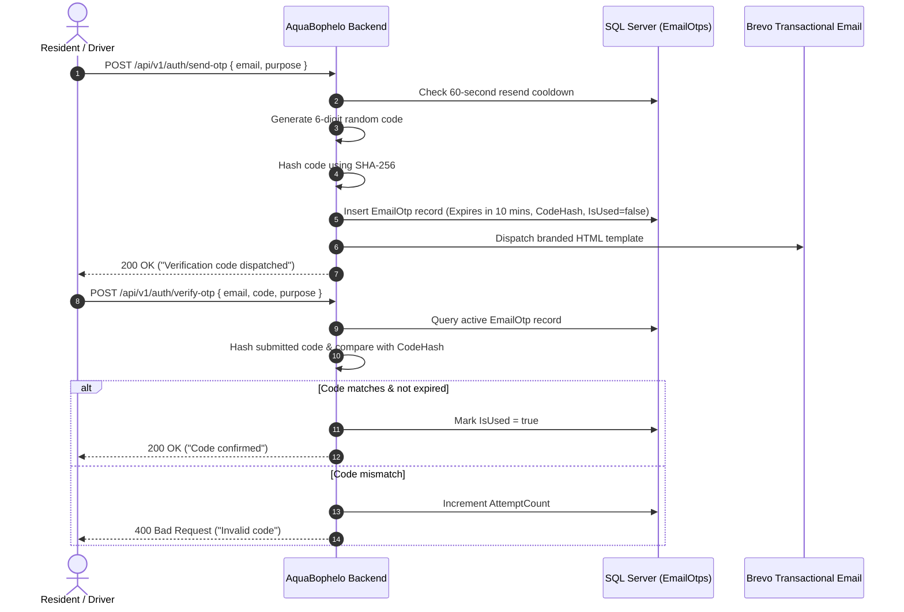

# Authentication & Identity Architecture (AUTH.md)

AquaBophelo uses **ASP.NET Core Identity** paired with **JSON Web Tokens (JWT)** for stateless, secure municipal identity management. This document explains the authentication lifecycle, role permissions, OTP verification mechanics, and brute-force defenses.

---

## 1. User Roles & Permission Matrix

AquaBophelo enforces a 3-tier Role-Based Access Control (RBAC) model. Role verification occurs strictly on the server via `[Authorize(Roles = "...")]` attributes:

| Role | Intended Audience | Permissions | Landing Dashboard |
| :--- | :--- | :--- | :--- |
| **Resident** | Kimberley citizens & residents | View public dam levels, view water tanker map, log fault reports, subscribe to area alerts, manage personal notification preferences. | `/dashboard` |
| **Driver** | Municipal tanker drivers | View assigned tanker routes and stops, broadcast live GPS location telemetry, report mechanical or road issues. | `/driver/trip` |
| **Admin** | Municipal water dispatchers | Full administrative dashboard, broadcast alerts, manage water tankers and routes, view and triage fault reports, review system audit logs. | `/admin` |

---

## 2. JWT Token Architecture

* **Algorithm:** HMAC-SHA256 (`HmacSha256`)
* **Lifespan:** 120 minutes (configurable via `Jwt:ExpiryMinutes` in appsettings or secrets).
* **Claims Embedded in Token:**
  * `ClaimTypes.NameIdentifier`: Unique user GUID (`ApplicationUser.Id`).
  * `ClaimTypes.Email`: Registered email address.
  * `ClaimTypes.Name`: User's full name.
  * `ClaimTypes.Role`: User's primary role (`Admin`, `Driver`, or `Resident`).
* **Storage Location:** Stored in browser `localStorage` as `aquabophelo_token` alongside user profile metadata (`aquabophelo_user`).

### Trade-Offs (localStorage vs. httpOnly Cookie)
* **Current Choice:** `localStorage` allows simple header attachment across standard Axios REST calls and SignalR WebSocket queries (`?access_token=...`).
* **Security Mitigation:** Cross-Site Scripting (XSS) is mitigated by React's default HTML output encoding, strict Content Security Policies, and lack of `dangerouslySetInnerHTML` on user-supplied content.

---

## 3. Account Lockout & Brute-Force Defense (AUTH-04)

To prevent automated password guessing attacks, ASP.NET Identity lockout is enforced:
* **Max Failed Attempts:** 5 consecutive failed logins.
* **Lockout Duration:** 15 minutes.
* **Mechanism:**
  * Each failed password call to `POST /api/v1/auth/login` invokes `_userManager.AccessFailedAsync(user)`.
  * If the counter hits 5, `_userManager.IsLockedOutAsync(user)` returns `true`, triggering a security audit log entry (`USER_LOCKED_OUT`) and returning:
    > *"Account has been temporarily locked due to 5 failed login attempts. Please try again in 15 minutes."*
  * Subsequent attempts during the lockout return the exact remaining minutes.
  * A successful login calls `_userManager.ResetAccessFailedCountAsync(user)`, clearing the strike counter.

---

## 4. Single-Use Email OTP Flow

Verification codes are used for email confirmation, password resets, and account deletion.

### Security Properties of OTPs:
1. **Cryptographic Hashing:** Plaintext OTPs are never stored in the database. Only the SHA-256 hash is saved.
2. **Attempt Limiting:** If `AttemptCount >= 5`, the OTP record is invalidated (`IsUsed = true`), blocking brute-force code guessing.
3. **Resend Cooldown:** Users must wait 60 seconds between resend requests to protect the municipal Brevo email quota.

---

## 5. Soft-Deactivation & Data Protection (AUTH-05)

When a resident requests account deletion or an administrator deactivates a user:
1. `ApplicationUser.IsDeleted` is set to `true`, and `DeletedAt` is recorded.
2. The account enters a **30-day grace period** (`ScheduledPermanentDeletionAt`), complying with municipal record retention guidelines.
3. EF Core Global Query Filter `builder.Entity<ApplicationUser>().HasQueryFilter(u => !u.IsDeleted)` hides deactivated records from standard queries.
4. If a deactivated user attempts to log in or reset a password, the system checks `IgnoreQueryFilters()` and returns:
   > *"This account has been deactivated. Please contact municipal support or register a new account."*

---

## 6. Client-Side Session Expiry Auto-Redirect (AUTH-06)

In [`frontend/src/api/client.js`](file:///c:/Users/Sisekelo%20Masombuka/source/repos/AquaBophelo/frontend/src/api/client.js), an Axios response interceptor monitors all responses:
* If an API endpoint returns `401 Unauthorized` and an `aquabophelo_token` exists in `localStorage`:
  1. It removes `aquabophelo_token` and `aquabophelo_user`.
  2. If the user is on a protected route, it redirects to `/login?expired=true`.
* [`frontend/src/pages/Login.jsx`](file:///c:/Users/Sisekelo%20Masombuka/source/repos/AquaBophelo/frontend/src/pages/Login.jsx) detects the `expired=true` URL query parameter and renders an informational banner:
  > *"Your session has expired. Please sign in again to continue."*
